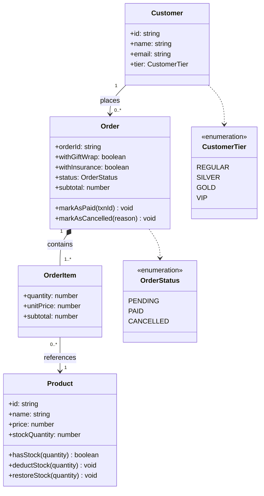

# KIẾN TRÚC HỆ THỐNG CLEAN ARCHITECTURE & MÔ HÌNH THỰC THỂ
## ĐỀ TÀI: HỆ THỐNG QUẢN LÝ BÁN HÀNG VÀ THƯƠNG MẠI ĐIỆN TỬ

---

## 1. TỔNG QUAN VỀ CLEAN ARCHITECTURE
Hệ thống áp dụng mô hình kiến trúc phân tầng độc lập (Clean Architecture / Onion Architecture) nhằm tách biệt triệt để mã nguồn logic nghiệp vụ (Business Rules) khỏi frameworks, cơ sở dữ liệu và các dịch vụ bên thứ ba.

### Sơ đồ 4 Tầng Phân Lập (The Clean Architecture Layers):

Vòng trong cùng là Domain; càng ra ngoài càng gần framework/giao tiếp ngoại vi. Infrastructure và Presentation nằm **cùng ở vòng ngoài cùng** (không tầng nào bọc tầng kia), cả hai phụ thuộc vào trong qua Interface:

```
+-----------------------------------------------------------------------------+
|  VÒNG NGOÀI CÙNG                                                            |
|  Presentation (CLI Runner, Menu)      Infrastructure (VNPay/MoMo SDK,       |
|                                        Email/SMS Notification Observers)     |
|   +---------------------------------------------------------------------+   |
|   | 2. APPLICATION LAYER (OrderCheckoutService, Use Cases, DTO)         |   |
|   |   +-------------------------------------------------------------+   |   |
|   |   | 1. DOMAIN LAYER (Entities, Design Patterns, Interfaces)     |   |   |
|   |   |    - Entities: Product, Order, Customer, OrderItem          |   |   |
|   |   |    - Creational: Factory Method, Builder                    |   |   |
|   |   |    - Structural: Adapter, Decorator                         |   |   |
|   |   |    - Behavioral: Strategy, Observer                         |   |   |
|   |   +-------------------------------------------------------------+   |   |
|   +---------------------------------------------------------------------+   |
|                                                                             |
|  Hướng phụ thuộc: Presentation/Infrastructure --> Application --> Domain    |
+-----------------------------------------------------------------------------+
```

### Nguyên tắc Phụ thuộc một chiều (The Dependency Rule):
- Mã nguồn tầng bên trong không bao giờ import hoặc phụ thuộc trực tiếp vào tầng bên ngoài.
- Tầng ngoài giao tiếp với tầng trong thông qua **Interfaces** (Abstractions) đặt tại tầng Domain/Application.
- Thỏa mãn hoàn toàn **Nguyên lý Đảo ngược Phụ thuộc (DIP)** trong SOLID.

---

## 2. VỊ TRÍ GẮN KẾT CỦA CÁC DESIGN PATTERNS TRONG HỆ THỐNG

| Nhóm Pattern | Tên Pattern | Vị trí Kiến trúc | Vấn đề Giải quyết |
| :--- | :--- | :--- | :--- |
| **Creational** | **Factory Method** | `domain/patterns/creational/factory` | Đóng gói logic khởi tạo các đối tượng cổng thanh toán mà không làm lộ chi tiết lớp cụ thể. |
| **Creational** | **Builder** | `domain/patterns/creational/builder` | Xây dựng đối tượng `Order` phức tạp từng bước một, tránh constructor quá tải. |
| **Structural** | **Adapter** | `domain/patterns/structural/adapter` | Chuyển đổi giao diện API không tương thích của SDK ngoài (VNPay, MoMo) về interface chuẩn của hệ thống. |
| **Structural** | **Decorator** | `domain/patterns/structural/decorator` | Mở rộng tính năng tính giá động (thêm gói quà, bảo hiểm hàng dễ vỡ) tại runtime mà không dùng kế thừa cứng. |
| **Behavioral** | **Strategy** | `domain/patterns/behavioral/strategy` | Hoán đổi linh hoạt thuật toán chiết khấu (Regular, VIP, Khuyến mãi) tại thời điểm thực thi. |
| **Behavioral** | **Observer** | `domain/patterns/behavioral/observer` | Tự động phát sự kiện đồng bộ khi đơn đổi trạng thái `PAID`: trừ kho, gửi mail hóa đơn, gửi SMS. |

---

## 3. MÔ HÌNH THỰC THỂ DỮ LIỆU (DOMAIN ENTITIES)
- `Customer`: Quản lý thông tin khách hàng và phân hạng thành viên (`CustomerTier`: Regular, Silver, Gold, VIP).
- `Product`: Quản lý thông tin sản phẩm, giá bán cơ sở và số lượng tồn kho.
- `OrderItem`: Sản phẩm và số lượng mua kèm đơn giá tại thời điểm đặt hàng.
- `Order`: Đối tượng trung tâm chứa thông tin khách hàng, các mục mua, địa chỉ giao hàng, trạng thái đơn (`OrderStatus`) và mã giao dịch thanh toán (`paymentTransactionId`).
- `OrderStatus`: Enum vòng đời đơn hàng (`PENDING`, `PAID`, `CANCELLED`). Hệ thống hiện thực đủ cả hai luồng: `PENDING -> PAID` (thanh toán, trừ kho) và `PENDING -> CANCELLED` (huỷ đơn, gửi thông báo huỷ). Tồn kho chỉ trừ tại `PAID` và chỉ hoàn cho đơn đã từng trừ — huỷ đơn `PENDING` không làm thay đổi tồn kho.

> Lưu ý vị trí: `InventoryUpdateObserver` thuộc Domain (logic trừ kho là nghiệp vụ lõi); `EmailNotificationObserver` và `SmsNotificationObserver` đặt tại Infrastructure (`infrastructure/observers`) vì là giao tiếp dịch vụ ngoại vi.

### Sơ đồ lớp Mô hình thực thể (Entity Class Diagram):



> Bản PlantUML chi tiết: `architecture/domain-model.puml`; bản render PNG: `diagrams-mermaid/domain-model.png`.
