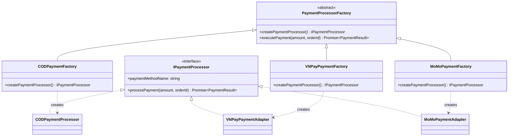
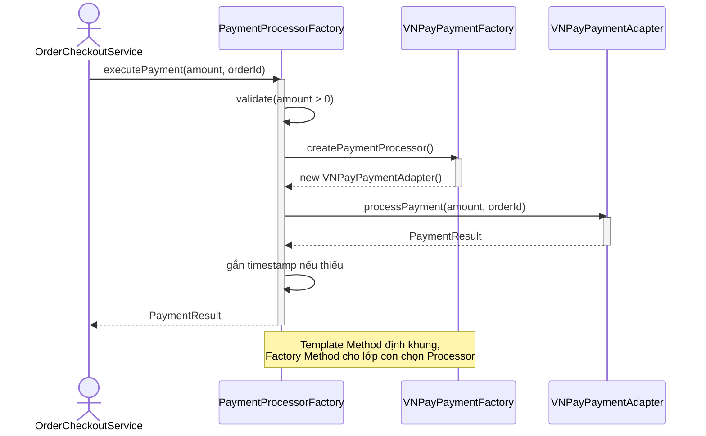

# PHÂN TÍCH & THIẾT KẾ CHI TIẾT: FACTORY METHOD PATTERN
**Nhóm:** Creational Pattern (Mẫu khởi tạo)

---

## 1. BÀI TOÁN NGHIỆP VỤ THỰC TẾ
Trong hệ thống TMĐT, việc thanh toán hỗ trợ nhiều phương thức:
- Thanh toán khi nhận hàng (COD).
- Chuyển khoản trực tiếp (Bank Transfer).
- Cổng thanh toán trực tuyến qua thẻ / ví điện tử (VNPay, MoMo).

Nếu hệ thống khởi tạo trực tiếp bằng toán tử `new` trong service xử lý đơn:
```typescript
// CODE TRUYỀN THỐNG VI PHẠM OCP:
if (method === 'COD') {
  processor = new CODPaymentProcessor();
} else if (method === 'BANK') {
  processor = new BankTransferProcessor();
} else if (method === 'VNPAY') {
  processor = new VNPayPaymentAdapter();
}
```
**Nhược điểm:**
- Khớp nối chặt (Tight Coupling) giữa tầng nghiệp vụ với các lớp thanh toán cụ thể.
- Vi phạm **Open/Closed Principle (OCP)**: Mỗi khi thêm cổng thanh toán mới (ví dụ ZaloPay), lập trình viên buộc phải can thiệp sửa đổi các lệnh `if-else` trong mã nguồn đang chạy ổn định.

---

## 2. GIẢI PHÁP VỚI FACTORY METHOD PATTERN
Định nghĩa phương thức nhà máy trừu tượng `createPaymentProcessor(): IPaymentProcessor` trong lớp cha `PaymentProcessorFactory`. Các lớp con cụ thể (`CODPaymentFactory`, `BankTransferPaymentFactory`, `VNPayPaymentFactory`) sẽ chịu trách nhiệm khởi tạo đối tượng tương ứng.

### Sơ đồ lớp (Class Diagram):



<details><summary>Sơ đồ ASCII (bản dự phòng)</summary>

```
       +------------------------------------+
       |  <<abstract>>                      |
       |  PaymentProcessorFactory           |
       +------------------------------------+
       | + createPaymentProcessor()         |
       | + executePayment(amount, orderId)  |
       +------------------------------------+
                     ^
         +-----------+-----------+
         |                       |
+-------------------+   +-----------------------+
| CODPaymentFactory |   | VNPayPaymentFactory   |
+-------------------+   +-----------------------+
| + createPayment.. |   | + createPayment..     |
+-------------------+   +-----------------------+
         |                       | (creates)
         v                       v
+-------------------+   +-----------------------+
| CODPaymentProc..  |   | VNPayPaymentAdapter   |
+-------------------+   +-----------------------+
         \                       /
          \                     /
           v                   v
      +-----------------------------+
      |      <<interface>>          |
      |    IPaymentProcessor        |
      +-----------------------------+
      | + paymentMethodName: string |
      | + processPayment(...): Promise|
      +-----------------------------+
```

</details>

### Sơ đồ tuần tự (Sequence Diagram):



---

## 3. SO SÁNH ƯU/NHƯỢC ĐIỂM SO VỚI THIẾT KẾ THÔNG THƯỜNG

| Tiêu chí | Dùng `if-else` + `new` trực tiếp | Dùng Factory Method |
| :--- | :--- | :--- |
| Thêm cổng mới | Sửa khối `if-else` trong service (vi phạm OCP) | Thêm 1 class Factory, không sửa code cũ |
| Khớp nối | Service biết mọi lớp Processor cụ thể | Service chỉ biết abstraction |
| Kiểm thử | Khó mock, phải dựng cả nhánh điều kiện | Mock Factory dễ dàng |
| **Nhược điểm của pattern** | — | Tăng số lượng class (mỗi sản phẩm 1 Factory); với hệ nhỏ có thể là over-engineering |

---

## 4. CHỨNG MINH TUÂN THỦ NGUYÊN LÝ SOLID
- **Single Responsibility Principle (SRP):** Trách nhiệm khởi tạo đối tượng thanh toán tách rời khỏi lớp thực thi và lớp dịch vụ đơn hàng.
- **Open/Closed Principle (OCP):** Thêm cổng ZaloPay chỉ cần tạo `ZaloPayPaymentProcessor` + `ZaloPayPaymentFactory`, không sửa dòng nào trong `OrderCheckoutService`.
- **Liskov Substitution Principle (LSP):** Mọi `ConcreteFactory` thay thế được `PaymentProcessorFactory`; mọi Processor trả về đều tuân thủ hợp đồng `IPaymentProcessor`, dùng thay nhau không phá tính đúng đắn.
- **Interface Segregation Principle (ISP):** `IPaymentProcessor` chỉ gồm `processPayment()` và `paymentMethodName`, không ép Processor implement hàm thừa.
- **Dependency Inversion Principle (DIP):** Client chỉ tương tác qua `PaymentProcessorFactory` và `IPaymentProcessor` (abstraction), không phụ thuộc lớp cụ thể.
