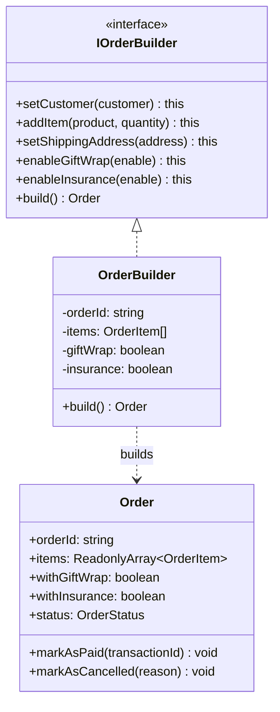
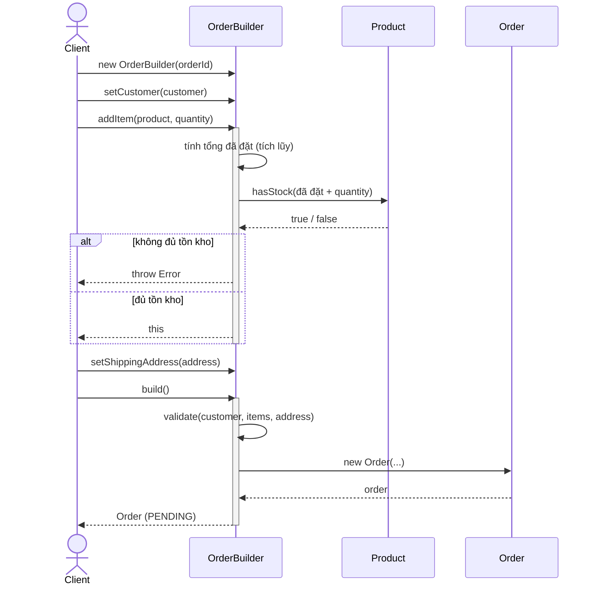

# PHÂN TÍCH & THIẾT KẾ CHI TIẾT: BUILDER PATTERN
**Nhóm:** Creational Pattern (Mẫu khởi tạo)

---

## 1. BÀI TOÁN NGHIỆP VỤ THỰC TẾ
Đối tượng đơn hàng (`Order`) trong hệ thống Thương mại điện tử có cấu trúc phức tạp với nhiều thuộc tính bắt buộc và tùy chọn:
- Bắt buộc: Mã đơn, Khách hàng, Danh sách mặt hàng (`OrderItem[]`), Địa chỉ giao hàng.
- Tùy chọn: Gói quà trang trọng (`withGiftWrap`), Bảo hiểm vận chuyển (`withInsurance`), Ghi chú đặc biệt (`specialNotes`).

Nếu sử dụng Constructor thông thường:
```typescript
// CODE TRUYỀN THỐNG VI PHẠM (Telescoping Constructor):
new Order(
  id, customer, items, address, 
  true,  // giftWrap?
  false, // insurance?
  "Giao gio hanh chinh", // notes
  undefined, // paymentTxn?
  OrderStatus.PENDING
);
```
**Nhược điểm:**
- Dễ nhầm lẫn thứ tự các tham số kiểu boolean (`true`, `false`).
- Khi thêm hoặc bớt thuộc tính, Constructor phình to, phá vỡ tính tương thích của mã nguồn hiện có.
- Khó kiểm soát logic kiểm tra tính hợp lệ dữ liệu (Validation) trước khi tạo đối tượng hoàn chỉnh.

---

## 2. GIẢI PHÁP VỚI BUILDER PATTERN
Tách biệt quá trình xây dựng đối tượng `Order` phức tạp khỏi biểu diễn của nó thông qua lớp `OrderBuilder` cung cấp giao diện Fluent Interface:
- `setCustomer(customer: Customer): this`
- `addItem(product: Product, quantity: number): this`
- `setShippingAddress(address: ShippingAddress): this`
- `enableGiftWrap(enable?: boolean): this`
- `enableInsurance(enable?: boolean): this`
- `setSpecialNotes(notes: string): this`
- `build(): Order`

### Sơ đồ lớp (Class Diagram):



<details><summary>Sơ đồ ASCII (bản dự phòng)</summary>

```
+--------------------+            creates           +------------------------+
|   OrderBuilder     | ---------------------------> |         Order          |
+--------------------+                              +------------------------+
| - customer         |                              | - orderId: string      |
| - items: Item[]    |                              | - customer: Customer   |
| - shippingAddress  |                              | - items: OrderItem[]   |
| - giftWrap: bool   |                              | - shippingAddress      |
| - insurance: bool  |                              | - withGiftWrap: bool   |
+--------------------+                              | - withInsurance: bool  |
| + setCustomer()    |                              | - status: OrderStatus  |
| + addItem()        |                              +------------------------+
| + enableGiftWrap() |                              | + markAsPaid(...)      |
| + build(): Order   |                              | + subtotal: number     |
+--------------------+                              +------------------------+
```

</details>

### Sơ đồ tuần tự (Sequence Diagram):



---

## 3. SO SÁNH ƯU/NHƯỢC ĐIỂM SO VỚI THIẾT KẾ THÔNG THƯỜNG

| Tiêu chí | Telescoping Constructor | Dùng Builder |
| :--- | :--- | :--- |
| Đọc hiểu | Chuỗi `true, false, undefined` khó đoán nghĩa | `.enableGiftWrap().enableInsurance()` tự mô tả |
| Validation | Rải rác hoặc dồn hết vào constructor | Tập trung ở `build()`, có thể tích lũy theo từng bước |
| Thêm thuộc tính | Phá vỡ chữ ký constructor, sửa mọi call site | Thêm 1 method, call site cũ không đổi |
| **Nhược điểm của pattern** | — | Thêm 1 lớp Builder; với object đơn giản là thừa |

---

## 4. CHỨNG MINH TUÂN THỦ NGUYÊN LÝ SOLID
- **Single Responsibility Principle (SRP):** Dựng + validate thuộc về `OrderBuilder`; `Order` chỉ giữ trạng thái dữ liệu nội tại.
- **Open/Closed Principle (OCP):** Thêm thuộc tính tùy chọn mới (vd `referralCode`) chỉ cần thêm method vào Builder, không xáo trộn call site cũ.
- **Liskov Substitution Principle (LSP):** `OrderBuilder` implement `IOrderBuilder`; mọi Builder tuân thủ hợp đồng này đều thay thế được nhau trong code client.
- **Interface Segregation Principle (ISP):** `IOrderBuilder` chỉ khai báo các bước dựng đơn, không trộn logic thanh toán/thông báo.
- **Dependency Inversion Principle (DIP):** Client lập trình theo `IOrderBuilder` (abstraction), không buộc phải phụ thuộc lớp `OrderBuilder` cụ thể.
