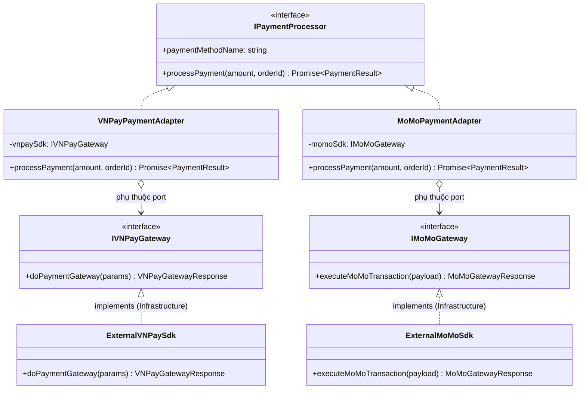
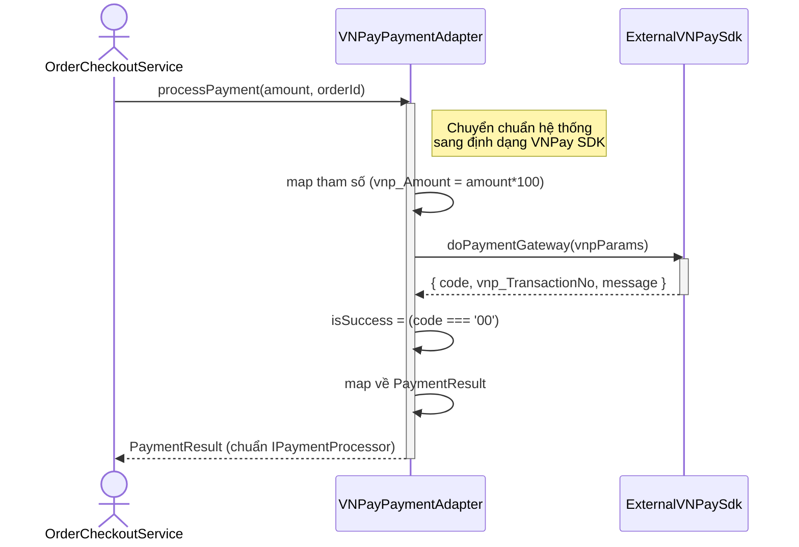

# PHÂN TÍCH & THIẾT KẾ CHI TIẾT: ADAPTER PATTERN
**Nhóm:** Structural Pattern (Mẫu cấu trúc)

---

## 1. BÀI TOÁN NGHIỆP VỤ THỰC TẾ
Hệ thống TMĐT cần tích hợp các cổng thanh toán số từ nhiều đối tác bên thứ ba (VNPay, MoMo). Mỗi đối tác cung cấp một bộ SDK hoặc định dạng API riêng biệt không đồng nhất:
- `ExternalVNPaySdk`: Yêu cầu hàm `doPaymentGateway({ vnp_TmnCode, vnp_Amount, vnp_TxnRef })` với số tiền phải nhân 100 và trả về kết quả qua thuộc tính `code === '00'`.
- `ExternalMoMoSdk`: Yêu cầu hàm `executeMoMoTransaction({ partnerCode, orderId, amount })` và trả về kết quả qua `status === 0`.

Trong khi đó, tầng nghiệp vụ của hệ thống đòi hỏi một chuẩn giao tiếp thống nhất:
```typescript
interface IPaymentProcessor {
  processPayment(amount: number, orderId: string): Promise<PaymentResult>;
}
```

Nếu gọi trực tiếp SDK trong luồng xử lý:
- Tầng nghiệp vụ bị phụ thuộc chặt chẽ (tight coupling) vào cấu trúc dữ liệu của các SDK bên thứ ba.
- Mỗi lần đối tác cập nhật phiên bản SDK, mã nguồn nghiệp vụ chính bị ảnh hưởng.

---

## 2. GIẢI PHÁP VỚI ADAPTER PATTERN
Sử dụng các lớp Adapter (`VNPayPaymentAdapter`, `MoMoPaymentAdapter`) để "phiên dịch" giao diện của thư viện bên ngoài về chuẩn `IPaymentProcessor`.

**Tuân thủ Dependency Rule (Clean Architecture):** Adapter nằm ở tầng Domain nên **không** import trực tiếp lớp SDK ở Infrastructure. Thay vào đó, Domain định nghĩa các *port* `IVNPayGateway` / `IMoMoGateway`; Adapter chỉ phụ thuộc port, còn lớp SDK thật (`ExternalVNPaySdk`, `ExternalMoMoSdk`) ở Infrastructure `implements` port đó. Mũi tên phụ thuộc đảo đúng chiều: Infrastructure → Domain.

### Sơ đồ lớp (Class Diagram):



<details><summary>Sơ đồ ASCII (bản dự phòng)</summary>

```
    +--------------------------------+
    |         <<interface>>          |
    |       IPaymentProcessor        |
    +--------------------------------+
    | + paymentMethodName: string    |
    | + processPayment(...): Promise |
    +--------------------------------+
                   ^
                   | implements
    +--------------------------------+          calls           +------------------------+
    |      VNPayPaymentAdapter       | -----------------------> |    ExternalVNPaySdk    |
    |                                |                          |       (Adaptee)        |
    +--------------------------------+                          +------------------------+
    | - vnpaySdk: ExternalVNPaySdk   |                          | + doPaymentGateway(..) |
    | + processPayment(amount, id)   |                          +------------------------+
    +--------------------------------+
```

</details>

### Sơ đồ tuần tự (Sequence Diagram):



---

## 3. SO SÁNH ƯU/NHƯỢC ĐIỂM SO VỚI THIẾT KẾ THÔNG THƯỜNG

| Tiêu chí | Gọi SDK trực tiếp trong service | Dùng Adapter |
| :--- | :--- | :--- |
| Phụ thuộc | Service dính cấu trúc riêng từng SDK | Service chỉ biết `IPaymentProcessor` |
| SDK đổi phiên bản | Sửa khắp nơi gọi SDK | Chỉ sửa trong 1 Adapter |
| Thay/thêm đối tác | Viết lại luồng nghiệp vụ | Viết thêm 1 Adapter, cắm vào Factory |
| **Nhược điểm của pattern** | — | Thêm 1 lớp trung gian + chi phí map dữ liệu mỗi lần gọi |

---

## 4. CHỨNG MINH TUÂN THỦ NGUYÊN LÝ SOLID
- **Single Responsibility Principle (SRP):** Adapter chỉ làm một việc: chuyển đổi định dạng dữ liệu và gọi phương thức của Adaptee.
- **Open/Closed Principle (OCP):** Tích hợp ZaloPay/Stripe chỉ cần viết thêm Adapter mới, giữ nguyên mã nguồn cũ.
- **Liskov Substitution Principle (LSP):** `VNPayPaymentAdapter`, `MoMoPaymentAdapter` dùng thay cho nhau và thay cho mọi `IPaymentProcessor` khác trong service mà không phá tính đúng đắn.
- **Interface Segregation Principle (ISP):** Adapter chỉ cần thỏa `IPaymentProcessor` gọn nhẹ, không bị ép theo giao diện phình to của SDK gốc.
- **Dependency Inversion Principle (DIP):** Hệ thống phụ thuộc abstraction `IPaymentProcessor`. Hơn nữa, Adapter phụ thuộc port `IVNPayGateway`/`IMoMoGateway` do Domain định nghĩa — lớp SDK cụ thể ở Infrastructure `implements` port và được tiêm vào qua constructor. Domain hoàn toàn không phụ thuộc Infrastructure (kiểm chứng: `grep -r infrastructure src/domain` không ra kết quả).
