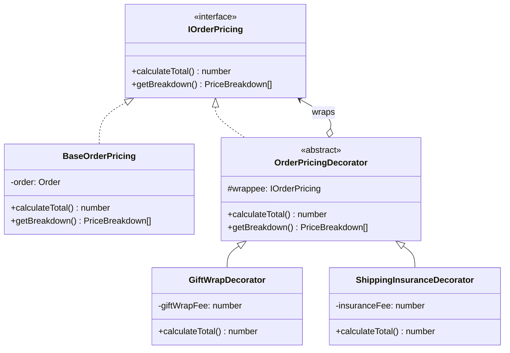
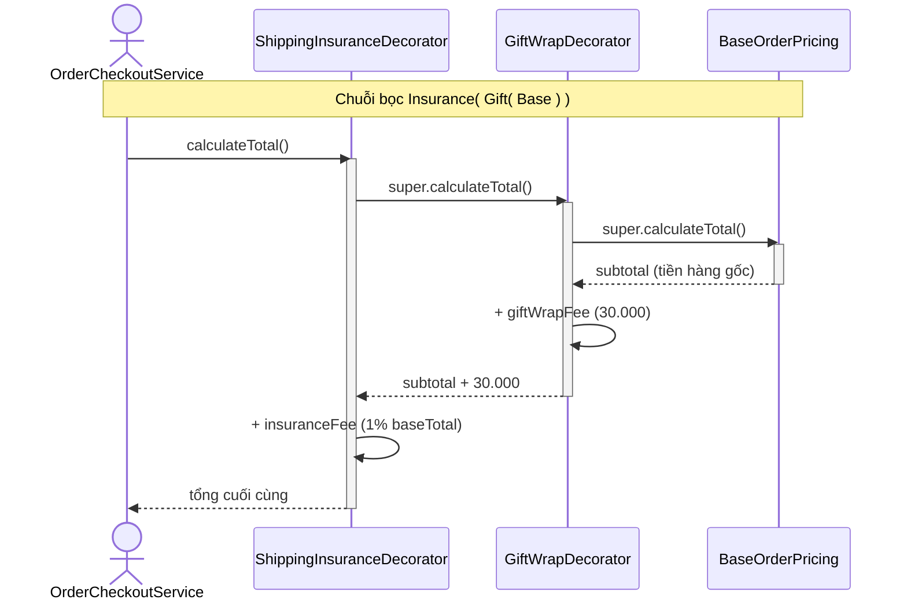

# PHÂN TÍCH & THIẾT KẾ CHI TIẾT: DECORATOR PATTERN
**Nhóm:** Structural Pattern (Mẫu cấu trúc)

---

## 1. BÀI TOÁN NGHIỆP VỤ THỰC TẾ
Đơn hàng cơ bản (`BaseOrderPricing`) có thể được bổ sung thêm nhiều dịch vụ giá trị gia tăng tùy theo yêu cầu của khách hàng:
- Dịch vụ đóng gói quà cao cấp và thiệp chúc mừng (`GiftWrapDecorator`: +30,000đ).
- Dịch vụ bảo hiểm hàng hóa vận chuyển (`ShippingInsuranceDecorator`: +1% giá trị đơn hàng).
- Trong tương lai: Dịch vụ giao hàng hỏa tốc trong 2h, dịch vụ lắp đặt tận nơi.

### Nguy cơ "Bùng nổ lớp con" (Class Explosion) nếu dùng Kế thừa:
Nếu cố gắng giải quyết bài toán này bằng cơ chế kế thừa đơn thuần (Subclassing):
- $N = 2$ dịch vụ $\rightarrow 2^2 = 4$ lớp con: `BaseOrder`, `OrderWithGift`, `OrderWithInsurance`, `OrderWithGiftAndInsurance`.
- $N = 5$ dịch vụ $\rightarrow 2^5 = 32$ lớp con kết hợp! Cấu trúc này không thể duy trì và cực kỳ dễ sinh lỗi.

---

## 2. GIẢI PHÁP VỚI DECORATOR PATTERN
Định nghĩa Interface chung `IOrderPricing`:
- `BaseOrderPricing` đóng vai trò là Concrete Component tính tiền hàng ban đầu.
- `OrderPricingDecorator` là lớp trừu tượng duy trì tham chiếu đến đối tượng `IOrderPricing` được bọc.
- Các lớp con `GiftWrapDecorator` và `ShippingInsuranceDecorator` bọc lấy component và cộng dồn chi phí động tại thời điểm runtime:
```typescript
let pricing: IOrderPricing = new BaseOrderPricing(order);
if (order.withGiftWrap) pricing = new GiftWrapDecorator(pricing);
if (order.withInsurance) pricing = new ShippingInsuranceDecorator(pricing);
const total = pricing.calculateTotal();
```

### Sơ đồ lớp (Class Diagram):



<details><summary>Sơ đồ ASCII (bản dự phòng)</summary>

```
                       +-----------------------------+
                       |        <<interface>>        |
                       |        IOrderPricing        |
                       +-----------------------------+
                       | + calculateTotal(): number  |
                       | + getBreakdown(): Item[]    |
                       +-----------------------------+
                                      ^
                                      |
                 +--------------------+--------------------+
                 |                                         |
    +-------------------------+             +-----------------------------+
    |    BaseOrderPricing     |             |    OrderPricingDecorator    |
    +-------------------------+             +-----------------------------+
    | - order: Order          |             | # wrappee: IOrderPricing    |
    | + calculateTotal()      |             +-----------------------------+
    | + getBreakdown()        |                            ^
    +-------------------------+                            |
                                            +--------------+--------------+
                                            |                             |
                             +----------------------+      +-----------------------------+
                             |  GiftWrapDecorator   |      |  ShippingInsuranceDecorator |
                             +----------------------+      +-----------------------------+
                             | - giftWrapFee: number|      | - insuranceFee: number      |
                             | + calculateTotal()   |      | + calculateTotal()          |
                             +----------------------+      +-----------------------------+
```

</details>

### Sơ đồ tuần tự (Sequence Diagram):



---

## 3. SO SÁNH ƯU/NHƯỢC ĐIỂM SO VỚI THIẾT KẾ THÔNG THƯỜNG

| Tiêu chí | Kế thừa (subclass cho mỗi tổ hợp) | Dùng Decorator |
| :--- | :--- | :--- |
| Số lớp cho N dịch vụ | Bùng nổ 2^N tổ hợp | N Decorator, ghép tự do tại runtime |
| Bật/tắt dịch vụ | Cố định lúc biên dịch | Linh hoạt theo điều kiện runtime |
| Thêm dịch vụ mới | Thêm nhiều lớp tổ hợp | Thêm 1 Decorator |
| **Nhược điểm của pattern** | — | Nhiều lớp nhỏ, khó debug chuỗi bọc sâu; thứ tự bọc ảnh hưởng kết quả (phí bảo hiểm tính trên cả phí gói quà) |

---

## 4. CHỨNG MINH TUÂN THỦ NGUYÊN LÝ SOLID
- **Single Responsibility Principle (SRP):** Tách tính giá gốc và từng loại phí gia tăng vào các lớp độc lập.
- **Open/Closed Principle (OCP):** Thêm `ExpressDeliveryDecorator` chỉ cần tạo class mới, không chạm `BaseOrderPricing` hay Decorator khác.
- **Liskov Substitution Principle (LSP):** Mọi Decorator kế thừa `OrderPricingDecorator` và tuân thủ hợp đồng `IOrderPricing`, nên dùng thay cho component gốc ở bất kỳ đâu.
- **Interface Segregation Principle (ISP):** `IOrderPricing` chỉ gồm `calculateTotal()` và `getBreakdown()` — vừa đủ cho client tính tiền.
- **Dependency Inversion Principle (DIP):** Client và các Decorator đều phụ thuộc abstraction `IOrderPricing`, không phụ thuộc lớp cụ thể được bọc bên trong.
