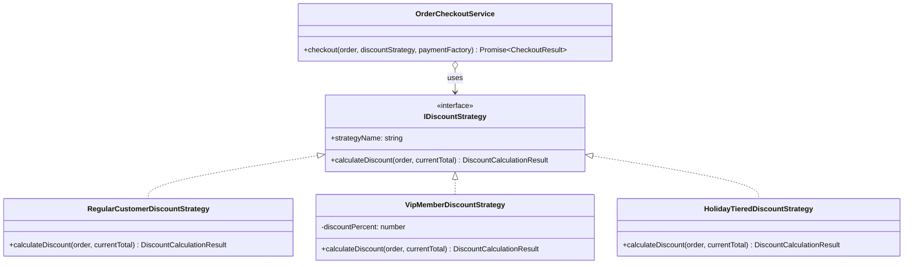
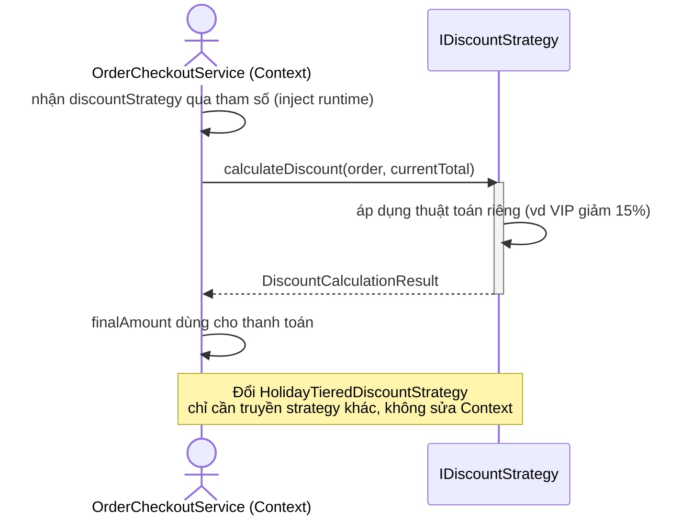

# PHÂN TÍCH & THIẾT KẾ CHI TIẾT: STRATEGY PATTERN
**Nhóm:** Behavioral Pattern (Mẫu hành vi)

---

## 1. BÀI TOÁN NGHIỆP VỤ THỰC TẾ
Doanh nghiệp TMĐT cần áp dụng nhiều chính sách chiết khấu khác nhau:
- Khách hàng tiêu chuẩn: Không giảm giá (`RegularCustomerDiscountStrategy`).
- Khách hàng VIP: Giảm 15% tổng hóa đơn (`VipMemberDiscountStrategy`).
- Sự kiện khuyến mãi Flash Sale: Giảm theo bậc giá trị đơn (`HolidayTieredDiscountStrategy`).

### Nhược điểm nếu dùng chuỗi điều kiện `switch-case` thông thường:
```typescript
// CODE TRUYỀN THỐNG VI PHẠM OCP:
function calculateDiscount(type: string, amount: number) {
  switch (type) {
    case 'VIP': return amount * 0.15;
    case 'HOLIDAY': return amount >= 5000000 ? 600000 : 200000;
    default: return 0;
  }
}
```
**Hậu quả:**
- Hàm tính toán ngày càng phình to (God Method).
- Thay đổi một chính sách có thể làm ảnh hưởng hoặc làm sai lệch chính sách khác.
- Không thể hoán đổi thuật toán linh hoạt hoặc nạp động từ cấu hình bên ngoài.

---

## 2. GIẢI PHÁP VỚI STRATEGY PATTERN
Định nghĩa Interface `IDiscountStrategy`:
- Tách rời từng thuật toán chiết khấu vào các lớp cụ thể độc lập.
- `OrderCheckoutService` đóng vai trò là Context, nhận vào một thể hiện của `IDiscountStrategy` và thực thi tính toán mà không quan tâm bên trong tính như thế nào.

### Sơ đồ lớp (Class Diagram):



<details><summary>Sơ đồ ASCII (bản dự phòng)</summary>

```
+-----------------------------------+               +--------------------------------------+
|       OrderCheckoutService        | ------------> |            <<interface>>             |
|             (Context)             |               |          IDiscountStrategy           |
+-----------------------------------+               +--------------------------------------+
| + checkout(order, strategy, fac)  |               | + strategyName: string               |
+-----------------------------------+               | + calculateDiscount(...): Result     |
                                                    +--------------------------------------+
                                                                       ^
                                                                       |
                             +-------------------------+---------------+-------------------------+
                             |                         |                                         |
               +---------------------------+ +------------------------+             +-------------------------------+
               | RegularCustomerDiscount.. | | VipMemberDiscountStrat |             | HolidayTieredDiscountStrategy |
               +---------------------------+ +------------------------+             +-------------------------------+
               | + calculateDiscount()     | | + calculateDiscount()  |             | + calculateDiscount()         |
               +---------------------------+ +------------------------+             +-------------------------------+
```

</details>

### Sơ đồ tuần tự (Sequence Diagram):



---

## 3. SO SÁNH ƯU/NHƯỢC ĐIỂM SO VỚI THIẾT KẾ THÔNG THƯỜNG

| Tiêu chí | `switch-case` theo loại khách | Dùng Strategy |
| :--- | :--- | :--- |
| Thêm chính sách | Sửa hàm tính giá (phình to, dễ sai) | Thêm 1 class Strategy |
| Khớp nối | Mọi chính sách dính chung 1 hàm | Mỗi thuật toán cô lập |
| Nạp động | Khó đổi thuật toán lúc chạy | Inject strategy bất kỳ tại runtime |
| **Nhược điểm của pattern** | — | Client phải biết các strategy để chọn; tăng số lượng class |

---

## 4. CHỨNG MINH TUÂN THỦ NGUYÊN LÝ SOLID
- **Single Responsibility Principle (SRP):** Mỗi thuật toán chiết khấu nằm trọn trong một lớp độc lập, dễ kiểm thử đơn vị.
- **Open/Closed Principle (OCP):** Thêm "Black Friday 50%" chỉ cần tạo `BlackFridayDiscountStrategy`, không đổi `OrderCheckoutService`.
- **Liskov Substitution Principle (LSP):** Ba strategy dùng thay cho nhau trong Context mà kết quả vẫn đúng hợp đồng `DiscountCalculationResult`.
- **Interface Segregation Principle (ISP):** `IDiscountStrategy` chỉ gồm `calculateDiscount()` và `strategyName`, không gộp hàm thừa.
- **Dependency Inversion Principle (DIP):** Context phụ thuộc abstraction `IDiscountStrategy`, không phụ thuộc thuật toán cụ thể nào.
