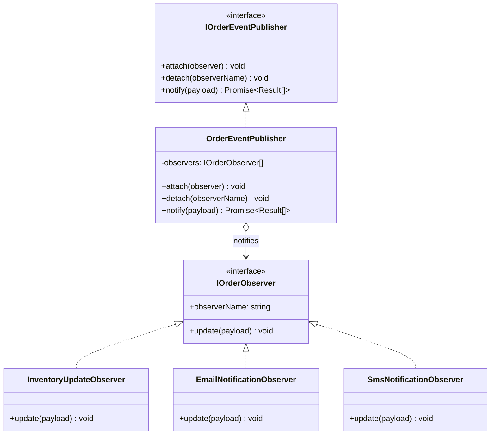
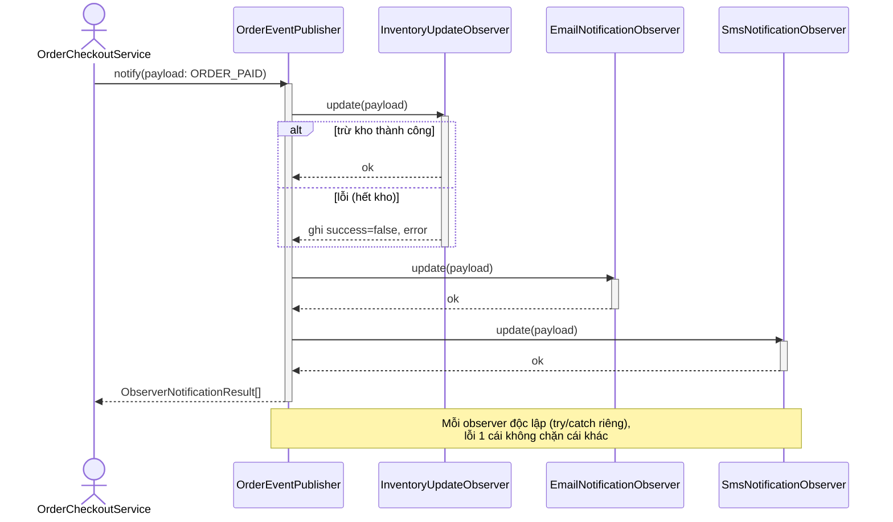

# PHÂN TÍCH & THIẾT KẾ CHI TIẾT: OBSERVER PATTERN
**Nhóm:** Behavioral Pattern (Mẫu hành vi)

---

## 1. BÀI TOÁN NGHIỆP VỤ THỰC TẾ
Khi đơn hàng chuyển trạng thái sang `PAID` (Đã thanh toán thành công), một loạt các hành động phụ thuộc cần được kích hoạt:
1. `InventoryUpdateObserver`: Trừ trực tiếp số lượng tồn kho của các sản phẩm đã bán.
2. `EmailNotificationObserver`: Gửi email xác nhận kèm hóa đơn chi tiết cho khách hàng.
3. `SmsNotificationObserver`: Gửi tin nhắn SMS mã đơn hàng đến số điện thoại người nhận.
4. Trong tương lai: Đẩy thông tin sang hệ thống CRM, tích điểm thành viên, hoặc gửi tin nhắn Zalo ZNS.

### Nhược điểm nếu gọi trực tiếp (Hardcoded method calls):
```typescript
// CODE TRUYỀN THỐNG VI PHẠM (Tight Coupling):
async function onOrderPaid(order: Order) {
  await inventoryService.deductStock(order);
  await emailService.sendReceipt(order);
  await smsService.sendTrackingCode(order);
  // Cứ thêm dịch vụ là lại sửa hàm này!
}
```
**Hậu quả:**
- Lớp xử lý đơn hàng bị phụ thuộc trực tiếp vào hàng loạt dịch vụ ngoại vi.
- Nếu một dịch vụ bị lỗi hoặc muốn tạm dừng (ví dụ tạm ngừng gửi SMS để tiết kiệm chi phí), phải sửa trực tiếp mã nguồn.

---

## 2. GIẢI PHÁP VỚI OBSERVER PATTERN
Xây dựng cơ chế xuất bản - đăng ký sự kiện (Publish-Subscribe):
- `OrderEventPublisher` (Subject) quản lý danh sách `IOrderObserver` thông qua các hàm `attach()`, `detach()`, `notify()`.
- Các dịch vụ ngoại vi triển khai `IOrderObserver` và đăng ký lắng nghe sự kiện từ Publisher.
- Khi đơn hàng hoàn tất, Publisher gọi `notify()` và truyền `OrderEventPayload`.

### Sơ đồ lớp (Class Diagram):



<details><summary>Sơ đồ ASCII (bản dự phòng)</summary>

```
+--------------------------------+                  +-------------------------------+
|      OrderEventPublisher       | <>-------------> |         <<interface>>         |
|           (Subject)            |                  |         IOrderObserver        |
+--------------------------------+                  +-------------------------------+
| - observers: IOrderObserver[]  |                  | + observerName: string        |
| + attach(observer)             |                  | + update(payload)             |
| + detach(observerName)         |                  +-------------------------------+
| + notify(payload): Promise     |                                  ^
+--------------------------------+                                  |
                                        +---------------------------+---------------------------+
                                        |                           |                           |
                          +---------------------------+ +-----------------------+ +-------------------------+
                          |  InventoryUpdateObserver  | | EmailNotificationObs  | |  SmsNotificationObserver|
                          +---------------------------+ +-----------------------+ +-------------------------+
                          | + update(payload)         | | + update(payload)     | | + update(payload)       |
                          +---------------------------+ +-----------------------+ +-------------------------+
```

</details>

### Sơ đồ tuần tự (Sequence Diagram):



Luồng: `notify(ORDER_PAID)` lặp qua từng observer đã `attach`, gọi `update()` trong `try/catch` độc lập; observer nào lỗi (vd hết kho) được ghi `{ success:false, error }` nhưng không chặn các observer còn lại. Service nhận `ObserverNotificationResult[]` và set cờ `hasObserverFailure` để xử lý bù.

### Sức mạnh thực sự: một Publisher, nhiều loại sự kiện
Hệ thống phát hai loại sự kiện qua **cùng một** `OrderEventPublisher`, mỗi Observer tự quyết định cách phản ứng theo `payload.event`:

| Observer | `ORDER_PAID` | `ORDER_CANCELLED` |
| :--- | :--- | :--- |
| `InventoryUpdateObserver` | Trừ tồn kho (`deductStock`) | **Hoàn** tồn kho (`restoreStock`) — chỉ cho đơn đã từng trừ (đã PAID); đơn PENDING chưa trừ thì bỏ qua, tránh cộng ảo |
| `EmailNotificationObserver` | Gửi hóa đơn điện tử | Gửi thông báo huỷ kèm lý do |
| `SmsNotificationObserver` | Gửi mã vận đơn | Gửi thông báo huỷ + hotline |

Điểm mấu chốt: `OrderCheckoutService.cancelOrder()` **không biết** có bao nhiêu Observer đang lắng nghe hay chúng làm gì — nó chỉ phát sự kiện. Muốn thêm hành vi khi huỷ đơn (ví dụ hoàn điểm thành viên, thông báo cho CRM), chỉ cần `attach` Observer mới, không sửa service.

---

## 3. SO SÁNH ƯU/NHƯỢC ĐIỂM SO VỚI THIẾT KẾ THÔNG THƯỜNG

| Tiêu chí | Gọi trực tiếp các service trong hàm `onOrderPaid` | Dùng Observer |
| :--- | :--- | :--- |
| Thêm/bớt kênh | Sửa hàm cốt lõi mỗi lần | `attach()`/`detach()` không sửa service |
| Khớp nối | Service biết mọi service ngoại vi | Chỉ biết `IOrderObserver` |
| Chịu lỗi | 1 service lỗi dễ làm hỏng cả luồng | Mỗi observer bọc `try/catch` riêng |
| **Nhược điểm của pattern** | — | Khó lần thứ tự/chuỗi phản ứng khi nhiều observer; lỗi bị "nuốt" nếu không có cờ cảnh báo |

---

## 4. CHỨNG MINH TUÂN THỦ NGUYÊN LÝ SOLID
- **Single Responsibility Principle (SRP):** Mỗi observer lo đúng một việc (trừ kho / gửi email / gửi SMS); Publisher chỉ lo điều phối phát sự kiện.
- **Open/Closed Principle (OCP):** Thêm kênh Zalo/Telegram chỉ cần tạo observer mới và `attach()`, không sửa `OrderCheckoutService`.
- **Liskov Substitution Principle (LSP):** Mọi observer tuân thủ `IOrderObserver` đều được Publisher đối xử như nhau, thay thế được cho nhau.
- **Interface Segregation Principle (ISP):** `IOrderObserver` chỉ gồm `observerName` và `update()`, không ép observer implement hàm thừa.
- **Dependency Inversion Principle (DIP):** Publisher chỉ phụ thuộc abstraction `IOrderObserver`, không biết lớp cụ thể.
